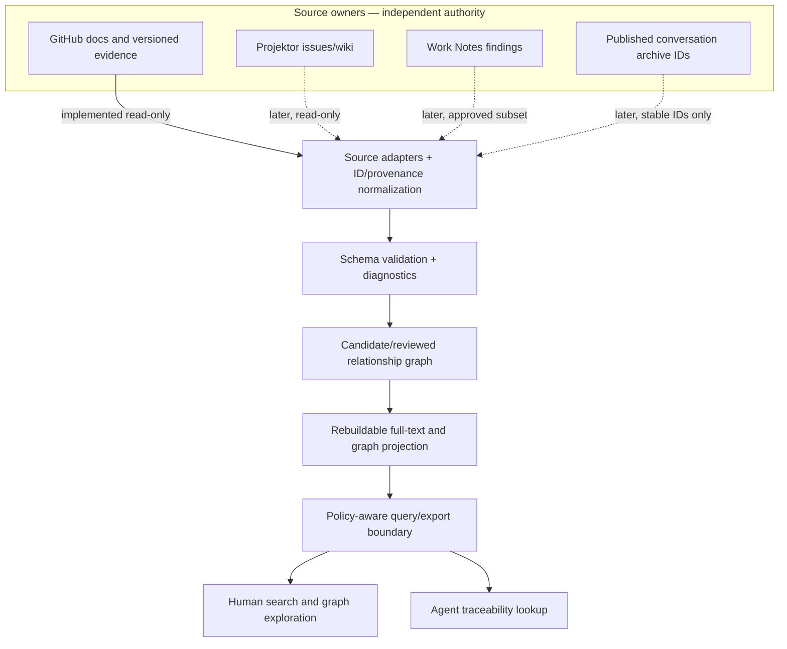

# Cross-project knowledge index — design, reasoning and integration proposal

**Status:** proposed design informed by a working, experimentally tested prototype. The implementation remains on [draft PR #61](https://github.com/rock-solid-sites/ASES/pull/61) and is **not merged, deployed, or authorized as a maintained shared service**. ASES-19 tracks this initiative; ASES-18 is its first research use case.

This document explains **why the system should exist, why its boundaries are arranged this way, what it has demonstrated and what independent reviewers must decide before integration**. The [implementation reference](../../../scripts/knowledge_index/TECHNICAL.md) gives the exact code/data/test contracts; the [final-review checklist](Final%20Review%20Checklist.md) captures the decision gates without mixing them into project history.

## Decision to be reviewed

Build **one reusable knowledge-linking substrate**, not a special-purpose bibliography database or another conversation archive. It should let an operator or research agent answer:

- Which findings, experiments and documents support, challenge or leave untested a concept?
- Where does an ASES design intersect prior distributed-systems work, and which comparison is still hypothetical?
- What decisions have become stale or been superseded, and what evidence must be revisited?
- Which dependencies connect a design, a requirement, its implementation and tests, without collapsing their separate authority?

The graph is a **derived index of references and evidence assertions**, not a source of policy, task execution, or truth. It must be cheap to regenerate and safe to discard. The human must be able to follow any substantive claim back to the owned source.

## Where it fits in our ecosystem

| Component / owner | What it owns | What the knowledge index may read or contribute |
| --- | --- | --- |
| GitHub project repositories | Technical source, experiments, code, canonical/experimental documents, versioned assertions | Read owned documents and explicit references; preserve path, source revision and authority; never alter source |
| EDASES research | Hypotheses, evidence, disagreements, confidence, falsifiable tests | Index claims and research links as **candidates** unless independently reviewed |
| ASES methodology | Approved engineering procedure derived from research | Link research and test evidence to methodology, without automatic methodological promotion |
| Execution Engine | Authorized Work Unit execution and implementation | May consume **approved** discovery/traceability information later; the index neither schedules Work Units nor owns the Kernel or Resource Solver |
| Projektor (human-facing) | Portfolio/project/module planning, issue decisions and human progress | In a later adapter, read approved issue/wiki IDs and explicit links; optionally provide a read-only related-knowledge view; do not replace PJDEV-9 |
| Work Notes (agent-facing) | Machine-readable operational work status and tracking | Later, read specific findings and references through a controlled connector; no task-state writes |
| Conversation archive | Original records, classifications, completeness, deduplication, archive search | Later, read **published stable references** only. Preserve independent CHATARCH-3 processing and security; no archive writes |

The last three columns are **integration intentions**, not implemented connectors. Source ownership is always upstream of indexing.

**Crucial separation:** archival work does not block this system. Even if CHATARCH-3 has unresolved conversations, the index can rebuild from existing GitHub records. Conversely, importing selected archive references must not mutate or reclassify any conversation or create a competing canonical archive.

## Design logic: why these mechanisms

### 1. Immutable identity, mutable location

A meaningful research concept or decision must not change identity merely because a Markdown file is renamed. Prefer source-native stable IDs (DOIs, issue IDs with workspace identity, archive UUIDs); permit a manually reviewed ID registry for legacy documents. Maintain former paths as aliases, but treat a title or string similarity as only a *discovery hint*, never authoritative identity. The prototype has an eight-document registry; most of the broader corpus is not yet stabilized. Renames should fail safely where identity cannot be preserved.

### 2. Typed relationships with an evidence status

Use directed edge types with defined meanings: `discusses`, `related_to`, `depends_on`, `supports`, `challenges`, `tests`, `implements`, `supersedes`. Every relationship should have explicit provenance, assessment, and review status. A parser-produced metadata link is evidence that a document **declares** a dependency, not that a reviewer has proven the dependency or that the relationship constitutes a scientific finding.

The first paper-to-ASES pilot deliberately marks its associations `candidate`. It does not claim the PNAS paper proves any Resource Solver architectural advantage or that ASES invented a concept.

### 3. Preserve each source's authority

A canonical ASES document may be connected to an experimental EDASES hypothesis, but the edge cannot grant the hypothesis canonical status. Similarly, Projektor issues may describe planned work without becoming technical standards. If two sources disagree, retain provenance and both assertions; flag contradiction for review instead of choosing a winner from recency, popularity or search score.

### 4. Deterministic projections instead of synchronized truth copies

Keep Git-tracked Markdown and structured assertions as source records. Normalize them into an ephemeral search/graph projection. A failed index build should preserve the prior projection and report the failure. Rebuilds must not require a working archive, Projektor graph feature, embedding provider or hosted execution service. SQLite FTS5 is adequate for the small pilot; a larger system needs measured evidence before introducing a graph database or embedding stack.

### 5. Security at the source permission boundary, not graph colors

An edge, its endpoint, the existence of a node and its evidence references can all reveal private information. An actual shared system must compute visibility from **source authorization at query/export time**, handle revocation and avoid leaking relationships through search, statistics or topology. The prototype's visibility labels and public-only export are containment checks on trusted input; they are **not** an authenticated security boundary. Publishing a private archive or connector-derived graph in a public Git repository is forbidden.

### 6. Multiple read views, one derivation

A human should be able to search by words, navigate a local graph neighborhood and open the original document; an agent should be able to retrieve stable IDs and typed evidence without scraping the visualization. Both views must reflect the same filtered projection. The prototype produces SQLite search and traversal, GitHub-rendered Mermaid, offline self-contained HTML and JSON. The HTML is not a deployed app; the GitHub preview works as the first read-only interface.

## Reference architecture (proposed, not a deployed service)

The authorization box is a **future required integration boundary**, not a feature presently implemented. A public-only export exists; no dynamic source ACL checks exist. Dashed connectors are proposed. The prototype does not provide a shared runtime.

## Mechanisms and progress: evidence not extrapolation

The current implementation and its tests are described in [Technical Reference](../../../scripts/knowledge_index/TECHNICAL.md) and the [Research Test Record](../../research/Knowledge%20Index%20Prototype%20-%20Real%20Repository%20Test%20Record%202026-11-19.md).

| Requirement | Actual prototype status | Remaining uncertainty |
| --- | --- | --- |
| Read Markdown metadata / explicit JSONL | Implemented and exercised on real ASES docs | Full YAML compatibility and other repository conventions |
| Build search and graph projection | SQLite FTS5 and typed graph tested | Incremental updates, larger-scale performance |
| Preserve source provenance | SHA-256 content hash, source links, explicit edge evidence refs | Immutable commit permalinks; source ACL versions |
| Stable identities | Eight reviewed registry IDs; rename test passed | Most sources still have path-derived IDs; cross-project alias authority |
| Diagnostic classification | 84 events classified in broader ASES docs test | 71 unresolved/unverified; alias validation |
| Public graph export | Mermaid preview regenerated and checked in CI; offline HTML/JSON exercised | Browser accessibility audit, no deployment |
| Visibility containment | Private node/edge/evidence filtering and adversarial cases tested | Real authentication, revocation, cross-workspace isolation, inference |
| Chat archive independence | No archive integration or mutation | Future read-only adapter and versioned IDs |
| Projektor / Work Notes independence | No connector writes or graph migration | Optional adapters and Project/Work Notes scoping |
| Maintained implementation selection | Disposable Python prototype only | ASES realization/language/assurance gate |

**Verified test points:** [Run 44571399972](https://github.com/rock-solid-sites/ASES/actions/runs/44571399972) passed 25 implementation tests on the original docs snapshot (194 nodes, 303 candidate edges, 84 diagnostics). [Review-packet run 44574342042](https://github.com/rock-solid-sites/ASES/actions/runs/44574342042) passed **28 tests**, including documentation classification, link integrity and non-approval checks, with **196 nodes, 311 candidate edges and 86 diagnostics** after adding proposal documents. Counts are commit-scoped measurements, **not scientifically reviewed findings**.

## Recommended integration strategy

**First integrate the evidence and reproducible experiment; do not yet deploy the shared service.** Reviewers can accept the research framework, code as an explicitly temporary prototype, tests, CI and read-only GitHub diagram without accepting Python as the permanent implementation or introducing an unreviewed server. This keeps the successful work reusable without granting it production authority.

Then evaluate a maintained implementation against explicit requirements: input validation, stable identity across moves, provenance, evidence review, source ACL and revocation, incremental rebuild, bounded query resource use, accessibility, compatibility with current repositories, and inexpensive operation. Reuse existing indexing infrastructure where its interfaces and authorization actually fit; do not create another always-on service simply to display a small graph.

A later integration can be delivered in three independently reviewable increments:
1. **Local/repository-derived source index** — documented schema, validated importer, stable IDs, well-defined candidate/verified edge handling and deterministic projections.
2. **Permission-aware cross-source adapters** — one-way selected reads from Projektor, Work Notes and *published* archives, with tested tenant boundaries. No writes.
3. **Optional shared read-only user interface** — authenticated if needed; bounded graph neighborhoods and source links; separate hosting and cost approval.

This sequence is proposed, not an automatic implementation authorization. It avoids blocking the literature sweep or other ASES work on optional graph infrastructure.

## Independent review before merge/integration

Apply the [Final Review Checklist](Final%20Review%20Checklist.md), using the specific code/fixture/CI evidence rather than this proposal as proof. Reviewers should distinguish:

- **Research/design review:** Is the distinction between knowledge discovery, source authority, human work tracking and agent execution correct?
- **Implementation review:** Do imports, schema validation, identity migration, evidence filtering, source linking and generated views satisfy the stated invariants? Can counterexamples falsify them?
- **Security review:** Can private sources, private relation existence, metadata and revocation effects leak through public views or default query paths?
- **Integration review:** Would a cross-project adapter duplicate CHATARCH-3 or PJDEV-9, cross workspace permissions, create cyclic dependencies or introduce ongoing infra costs?
- **Assurance review:** Is the maintained realization justified under the existing ASES [language/assurance method](../../methodology/Implementation%20Realization%20and%20Assurance%20Selection%20Method.md)?

Independent reviewers must have permission to find **blocking failures**. A green test workflow is necessary evidence, not a substitute for adversarial review or environment-specific tests. Record findings with reproduction steps, source revisions, confidence and untested areas. Resolve blockers in a separate, verified revision before promotion.

## Proposed decision outcomes

**Approve for research use:** keep the versioned prototype, tests and preview available to researchers as experimental material, while ASES-19 tracks integration.

**Conditionally approve integration design:** accept source ownership and contracts, but require separately verified stable identity, authorization and maintained realization before any cross-project deployment.

**Reject/redesign components:** if independent review reveals an unguarded authority/permission boundary or the maintenance overhead exceeds demonstrated value, preserve the research evidence while replacing/discarding the implementation.

**Current recommendation:** the first two outcomes are plausible; production deployment approval is **not** supported by the present evidence. Leave PR #61 in draft until the review is completed and its scope of acceptance is explicitly stated.
