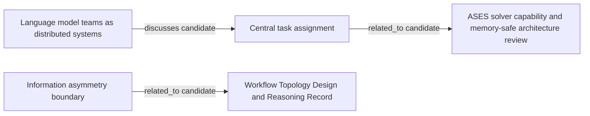

# Public research relationship graph

Generated read-only view. All graph edges are **candidate** links, not validated findings.

## Source references

- [Central task assignment](https://github.com/rock-solid-sites/ASES/blob/main/docs/research/LLM%20Agents%20and%20Distributed%20Systems%20-%20Research%20Topic.md) — concept, unspecified
- [Information asymmetry boundary](https://github.com/rock-solid-sites/ASES/blob/main/docs/research/Workflow%20Topology%20Design%20and%20Reasoning%20Record.md) — concept, unspecified
- [Language model teams as distributed systems](https://doi.org/10.1073/pnas.2612825123) — source, unspecified
- [ASES solver capability and memory-safe architecture review — 2026-11-01](https://github.com/rock-solid-sites/ASES/blob/main/docs/research/ASES%20Solver%20Capabilities%20and%20Rust%20Architecture%20Review%202026-11-01.md) — source, unspecified
- [Workflow Topology Design and Reasoning Record](https://github.com/rock-solid-sites/ASES/blob/main/docs/research/Workflow%20Topology%20Design%20and%20Reasoning%20Record.md) — source, Experimental

Visible subset: 5 nodes, 3 candidate edges.
